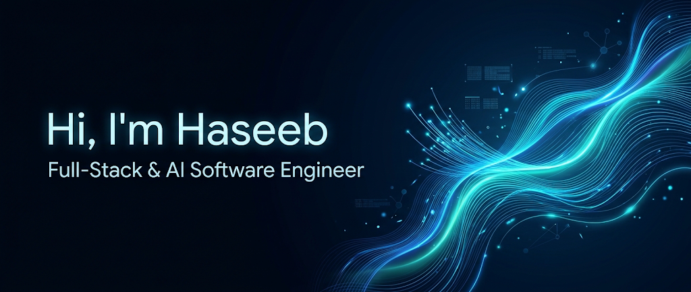

<!-- Animated Twinkling Hero Banner -->
<p align="center">
  
</p>

<!-- Animated Typing SVG -->
<p align="center">
  <a href="https://my-portfolio-4-lovat.vercel.app/">
    
  </a>
</p>

<!-- Social & Live Visitor Badges -->
<p align="center">
  <a href="https://my-portfolio-4-lovat.vercel.app/">
    
  </a>
  <a href="https://www.linkedin.com/in/haseeb-javed-dev/">
    
  </a>
  <a href="mailto:contactimhaseeb@gmail.com">
    
  </a>
  <a href="https://x.com/Haseebjaved4212">
    
  </a>
  
</p>

<!-- Gradient Divider -->
<p align="center">
  
</p>

### `whoami`

```yaml
name: Haseeb Javed
role: Full-Stack & AI Software Engineer
location: Karachi, Pakistan (Open to On-Site & Worldwide Remote)
currently:
  - Software Engineering Intern @ Pynexia Technology
  - Freelance Full-Stack & Agentic AI Engineer
focus:
  - Autonomous Multi-Agent Workflows & RAG Systems
  - Model Context Protocol (MCP) Integrations
  - High-Throughput Web APIs & Cross-Platform Mobile Apps
contact: contactimhaseeb@gmail.com