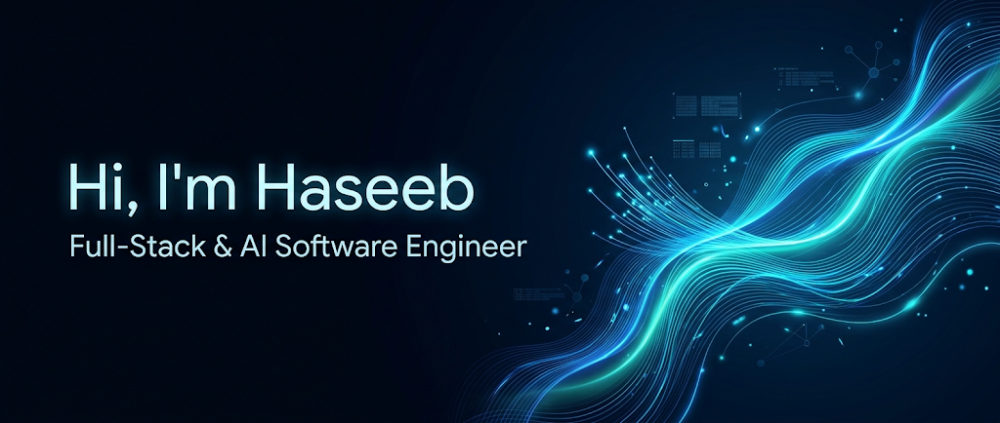

# Haseeb Javed

<div align="center">
  
</div>

  <p align="center">
    <strong>Building production-grade web interfaces, scalable backend APIs, and autonomous AI agent workflows.</strong>
  </p>

  <p align="center">
    <a href="https://www.linkedin.com/in/haseeb-javed-0332b3341/"></a>
    <a href="https://my-portfolio-4-lovat.vercel.app/"></a>
    <a href="mailto:contactimhaseeb@gmail.com"></a>
    <a href="https://github.com/haseebjaved4212"></a>
  </p>
</div>

---

## 👨‍💻 About Me

Full-Stack & AI Software Engineer based in Karachi, Pakistan, specializing in architecting modern responsive user interfaces, resilient distributed backends, and autonomous multi-agent AI systems. With hands-on delivery across React.js, Next.js (App Router), TypeScript, Python (FastAPI, Django), and Node.js, I bridge the gap between intelligent LLM reasoning and production-grade engineering.

My experience spans building zero-hallucination Retrieval-Augmented Generation (RAG) pipelines, Model Context Protocol (MCP) integrations, real-time analytics platforms, and low-level mobile audio engines for paying clients and open-source communities across 122+ repositories.

### 💡 What Drives Me

> I'm passionate about solving tangible, real-world problems through clean code. Whether it's orchestrating autonomous AI agents that eliminate repetitive business friction, designing safety-aware community routing, or tuning low-level DSP audio pipelines, I believe technology should make life simpler, safer, and infinitely more efficient.

---

## 🚀 Featured Projects

<table>
  <tr>
    <td width="50%" valign="top">
      <h3 align="center">VerteX</h3>
      <p align="center"><em>AI-Powered Course Search & Learning Platform</em></p>
      <p>An intelligent course discovery platform enabling users to query dense technical catalogs in natural language and jump straight to the exact video timestamp where a concept is explained.</p>
      <strong>Impact & Key Highlights:</strong>
      <ul>
        <li>Integrated <strong>Sanity Context MCP</strong> with OpenAI to index transcripts and chapter markers for timestamp-accurate video search.</li>
        <li>Architected a decoupled structure separating the Next.js App Router client from Sanity Studio with Clerk authentication.</li>
        <li>Instrumented comprehensive learner engagement and watch-depth retention funnels using PostHog analytics.</li>
      </ul>
      <p><strong>Tech Stack:</strong> <code>Next.js 14</code>, <code>TypeScript</code>, <code>Sanity MCP</code>, <code>OpenAI API</code>, <code>Clerk</code>, <code>PostHog</code></p>
      <p align="center">
        <a href="https://github.com/haseebjaved4212"><strong>Explore Repository »</strong></a>
      </p>
    </td>
    <td width="50%" valign="top">
      <h3 align="center">CoolBraze-Ai</h3>
      <p align="center"><em>Multi-Agent Autonomous Customer Support System</em></p>
      <p>A production-ready customer support automation engine powered by Django and the Claude API, replacing rigid legacy rulebooks with collaborative autonomous AI agents.</p>
      <strong>Impact & Key Highlights:</strong>
      <ul>
        <li>Orchestrated three collaborative AI agents to triage inbound queries, validate company policy constraints, and execute resolution actions.</li>
        <li>Automated end-to-end refund approvals and customer order workflows with zero human intervention required for standard cases.</li>
        <li>Built grounded RAG pipelines with vector retrieval to guarantee zero hallucinations on support policy documentation.</li>
      </ul>
      <p><strong>Tech Stack:</strong> <code>Python</code>, <code>Django</code>, <code>Claude API</code>, <code>RAG</code>, <code>Multi-Agent Systems</code>, <code>JavaScript</code></p>
      <p align="center">
        <a href="https://github.com/haseebjaved4212/CoolBraze-Ai"><strong>Explore Repository »</strong></a>
      </p>
    </td>
  </tr>
  <tr>
    <td width="50%" valign="top">
      <h3 align="center">AniTrack</h3>
      <p align="center"><em>Full-Stack Real-Time Media Tracker & Analytics Platform</em></p>
      <p>A centralized web platform and analytics dashboard engineered to consolidate fragmented watchlists and power real-time episode progress synchronizations across user sessions.</p>
      <strong>Impact & Key Highlights:</strong>
      <ul>
        <li>Architected high-throughput RESTful APIs in FastAPI and Django backed by Redis caching to eliminate state latency.</li>
        <li>Implemented secure stateless JWT authentication and granular session state management over PostgreSQL.</li>
        <li>Designed interactive visual analytics dashboards showcasing watch trends and completion trajectories.</li>
      </ul>
      <p><strong>Tech Stack:</strong> <code>Python</code>, <code>FastAPI</code>, <code>Django</code>, <code>TypeScript</code>, <code>Redis</code>, <code>PostgreSQL</code>, <code>JWT</code></p>
      <p align="center">
        <a href="https://github.com/haseebjaved4212/AniTrack"><strong>Explore Repository »</strong></a>
      </p>
    </td>
    <td width="50%" valign="top">
      <h3 align="center">AirPods-Control</h3>
      <p align="center"><em>Open-Source Android BLE & Custom DSP Engine</em></p>
      <p>A native open-source Android systems utility bridging hardware parity by restoring seamless Apple AirPods ecosystem controls on Android devices.</p>
      <strong>Impact & Key Highlights:</strong>
      <ul>
        <li>Reverse-engineered and implemented BLE protocols for real-time battery status, ANC/Transparency toggling, and optical in-ear detection.</li>
        <li>Engineered a custom 5-band graphic equalizer with low-latency 3D spatial virtualization.</li>
        <li>Designed a battery-efficient persistent Foreground Service with Room database event persistence.</li>
      </ul>
      <p><strong>Tech Stack:</strong> <code>Kotlin</code>, <code>Jetpack Compose</code>, <code>Android BLE APIs</code>, <code>Room DB</code>, <code>Custom DSP Engine</code></p>
      <p align="center">
        <a href="https://github.com/haseebjaved4212/AirPods-Clone-Controle"><strong>Explore Repository »</strong></a>
      </p>
    </td>
  </tr>
</table>

---

## 🛠️ Tech Stack

<div align="center">

### Frontend Development
<p align="center">
  
</p>

### Backend & AI Architecture
<p align="center">
  
</p>

### Databases, DevOps & Cloud Tools
<p align="center">
  
</p>

</div>

---

## 📊 GitHub Analytics

<div align="center">
  
  
</div>

<div align="center" style="margin-top: 10px;">
  
  
</div>

---

## 💻 Current Focus & Interests

```javascript
const haseeb = {
  pronouns: "he/him",
  role: "Full-Stack & AI Software Engineer",
  location: "Karachi, Pakistan (Open to Worldwide Remote & On-Site)",
  interests: [
    "Autonomous Multi-Agent Orchestration & Workflows",
    "Model Context Protocol (MCP) Server Architectures",
    "Production Retrieval-Augmented Generation (RAG)",
    "Scalable High-Throughput APIs (FastAPI, Django, NestJS)"
  ],
  stack: {
    frontend: ["Next.js (App Router)", "React.js", "TypeScript", "Tailwind CSS"],
    backend: ["Python (FastAPI, Django DRF)", "Node.js (NestJS, Express)"],
    ai_agentic: ["Claude API", "OpenAI API", "RAG Systems", "MCP Context"],
    databases: ["PostgreSQL", "Redis", "MongoDB", "SQLite", "Room DB"]
  },
  passions: [
    "Open-Source Systems Engineering (122+ Repositories)",
    "Clean Architecture & Resilient API Design",
    "Low-Latency DSP & Hardware Interoperability"
  ],
  openFor: [
    "Full-Stack & AI Engineering Opportunities",
    "Agentic AI & RAG Consulting / Contracts",
    "High-Impact Open Source Collaborations"
  ]
};
```

---

## 🌟 Beyond Code

<table>
  <tr>
    <td width="25%" align="center">
      <br />
      <strong>Audio Tech & DSP</strong><br />
      <sub>Tinkering with low-level BLE & 3D spatial virtualization</sub>
    </td>
    <td width="25%" align="center">
      <br />
      <strong>Ethics & Studies</strong><br />
      <sub>Pursuing Master's degree & ethical principles in tech</sub>
    </td>
    <td width="25%" align="center">
      <br />
      <strong>Open Source</strong><br />
      <sub>122+ public repositories & continuous experimentations</sub>
    </td>
    <td width="25%" align="center">
      <br />
      <strong>Civic & Safety Tech</strong><br />
      <sub>Prototyping safety-aware scoring & community routing</sub>
    </td>
  </tr>
</table>

---

## 📬 Let's Connect

<p align="center">
  <em>I'm always open to discussing new projects, ambitious engineering ideas, or opportunities to build impactful products together.</em>
</p>

<p align="center">
  <a href="https://www.linkedin.com/in/haseeb-javed-0332b3341/">
    
  </a>
  &nbsp;
  <a href="mailto:contactimhaseeb@gmail.com">
    
  </a>
  &nbsp;
  <a href="https://my-portfolio-4-lovat.vercel.app/">
    
  </a>
  &nbsp;
  <a href="https://github.com/haseebjaved4212">
    
  </a>
</p>

<div align="center">
  
</div>
